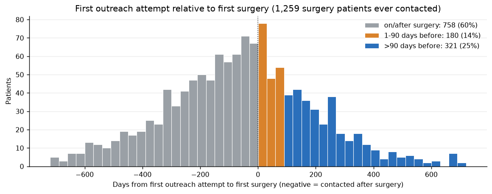
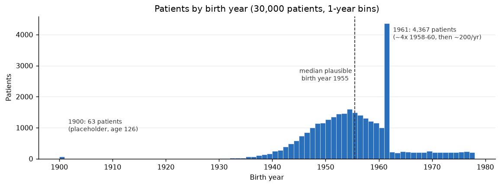
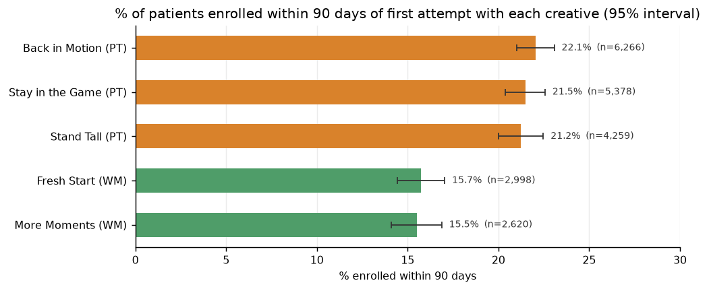
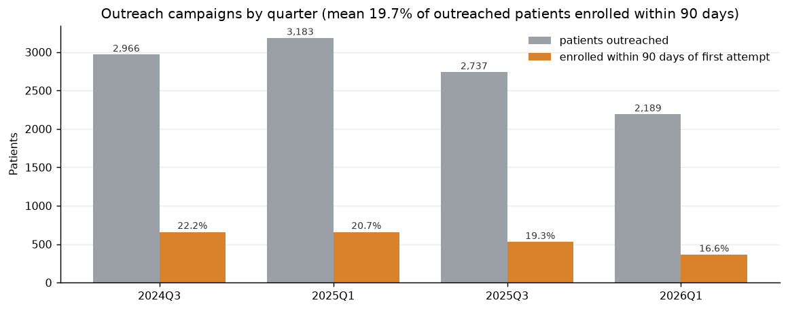
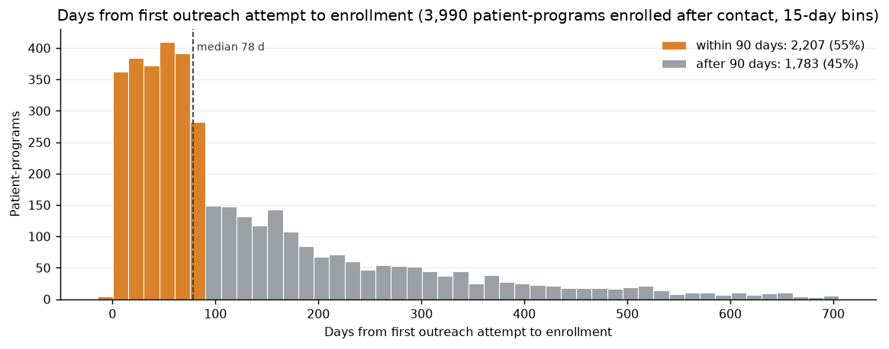

# Applied Data Science Take-Home

Start with [`client-brief.md`](client-brief.md). It describes the client, their problem and what they asked for. Then read [`assignment.md`](assignment.md), which covers what to produce, the submission contract and how it is evaluated.

## Setup

```bash
uv sync
```

## Run

```bash
uv run main.py train
uv run main.py score
```

To regenerate the README figures after training:

```bash
uv run python notebooks/readme_figures.py
```

## Test

```bash
uv run pytest
```

## Layout

- `main.py`: the entry point script.
- `assignment/`: the library where the assignment is implemented.
- `tests/`: tests.
- `data/`: the extract.
- `notebooks/`: the EDA notebook (`meridian_eda.ipynb`) and the README figure script.
- `figures/`: figures used in this README.
- [`DECISIONS.md`](DECISIONS.md): every design decision, with the reasoning and the numbers behind it.

---

# Methodology

## The problem
Meridian Health has seen recruitment success decline in its campaigns aimed at preventing lower back surgery. The problem has two parts:
1. Identify patients who are likely to need back surgery in the future, but far enough out that prevention is still possible.
2. Identify and prioritize the patients most likely to respond to recruitment campaigns and enroll in physical therapy (PT) and/or weight management (WM).

## The approach
I built a multi-stage prediction pipeline, run on every currently covered, recently active patient with no surgery evidence (17,747 patients):

| Stage | Question | Who it runs on |
|---|---|---|
| 1. Surgery prediction model | Is this patient heading toward lumbar spine surgery a year or more from now? | Everyone eligible |
| 2. Enrollment prediction models (PT, WM) | If we reach out, will they enroll rather than refuse? | Surgery-positive patients only |
| 3. Rules filtering | Is it still appropriate to contact them about this program? | PT- and/or WM-positive patients |

The output is `out/targets.csv` (`patient_token, program_recommended, score`), ranked by surgery score. `score` is the surgery risk, rescaled to a real-world annual rate (see [Score calibration](#score-calibration)).

**Why multiple stages instead of one model:**
- **The two questions have different labels and populations.** Every patient has a surgery outcome. Only patients Meridian has enrolled or contacted have an enrollment outcome. One model would have to learn both from the smallest of these populations.
- **Each stage needs its own feature exclusions.** PT activity is a legitimate surgery risk signal, but in the PT enrollment model it leaks "already in PT". Separate stages let each model ignore exactly what it must (see [Features](#features)).
- **The rules are business logic, not statistics.** Keeping them as a separate, deterministic step makes them easy to read, audit and change for each client (for example, a client whose programs allow re-enrollment) without retraining anything.
- **Generalizability.** Stages 1 and 2 only need claims-style data, so they can be reused for a new client. Stage 3 is where client-specific policy lives.

## The labels
**Surgery:** positive labels are patients with any of the CPT codes 22630, 22633, 63030 or 63047 (all the lumbar surgery codes) in the Data Web claims or the encounters table. I count these codes regardless of `claim_status` (`PAID`, `DENIED`, `DISPENSED`, `REJECTED`, `REVERSED`) or encounter status. Claim status is a business decision, not a clinical indicator, and the goal is to predict surgery, not whether the surgery is covered by insurance. 2,597 patients have a surgery code.

**Enrollment:** positve labels are patient who are enrolled in physical therapy or weight management - not necessarily patients who were in the outreach data since a large portion (42%) of enrolled patients were never contacted as part of a campaign [Enrollment prediction](#enrollment-prediction).

## Features
Features are built from both the Data Web claims, over a window before each patient's index date. For the surgery model, the window is all history up to 4 quarters before surgery (see [the time frame](#the-time-frame-x-quarters)). For the enrollment models, it is the 4 quarters before enrollment or refusal.
- **Code counts:** CPT, ICD-10, HCPCS and NDC codes, counted over the window. Only codes that more than 10 training patients have are kept.
- **Provider specialty counts:** claim lines per provider specialty (claims only).
- **Demographics:** age (2026 − birth year) and one-hot sex.

All counts and age are min/max scaled, with the range fitted on the training split only and then applied to val/test/holdout, so nothing leaks from evaluation data.

Encounters coverage of patients is lower (94%) than the Data Web's (100%). For scalability and generalizability to new clients, we can't rely on the quality, content or consistency of a client's encounters data, but we can rely on the Data Web. The feature module therefore takes a `sources` parameter, and a Data Web-only model is one argument away (`sources=("claims",)`).

### Ignoring codes and specialties in the feature module
Some codes are ignored because they correlate too closely with the label we are predicting. Rows with an ignored code count toward neither code features nor specialty counts.

| Codes | What they are | Ignored for | Why |
|---|---|---|---|
| 22630, 22633, 63030, 63047 | Lumbar fusion / laminectomy surgery | All models | They define the surgery label |
| 99204, 99244 | New patient / consultation office visits, recorded as `Surgical Consult` encounters | All models (forbidden) | They directly tell us the patient is already talking to a surgeon, which is too late for prevention. They were also the top two surgery features in the earlier, year-before-surgery version. |
| 97001, 97110 | PT evaluation / therapeutic exercise (`PT Referral`) | PT enrollment model only | They leak "already in PT" into the PT model |

In addition, the PT enrollment cohort **excludes patients with any prior Physical Therapy-specialty claims** before their index date, rather than just hiding the PT specialty column. Those patients may already be in PT care, and Meridian wouldn't market PT to them.

How to use it:

```python
from assignment.features import write_features

# default: surgery codes ignored; the surgical consult codes are always removed
write_features(4, splits_file=..., ignore_codes=("22630", "22633", "63030", "63047", "97001", "97110"))

# Data Web only, without provider specialties
write_features(4, splits_file=..., sources=("claims",), include_specialties=False)
```

The same options are on the command line (`python -m assignment.features --help`). The surgical consult codes are in `features.FORBIDDEN_FEATURE_CODES`, and `train.py` refuses any feature file that contains them.

### How I would ideally design features
Given more time and unfettered access to the illustrious Data Web, I would explore a sequence modeling approach that can use the timing of claims along the patient journey. Each event would carry a normalized time indicator (age at the date, or time since first encounter with a Meridian provider) with its medical codes, paired with the provider specialty where applicable.

### The time frame: X quarters
To predict surgery far enough ahead for prevention, I parameterized the splits with a gap of X quarters. The surgery model's features use **all of a patient's history up to X quarters before their index date** (the first surgery date for positives, a matched date for negatives). With X = 1 everything except the last quarter before surgery is used; with X = 2 everything except the last two quarters; and so on. The model therefore learns what a patient looks like at least X quarters before surgery. At scoring time it sees all history up to today, so it flags patients heading for surgery roughly X or more quarters from now.

| Gap X (quarters) | 1 | 2 | 3 | **4** | 6 | 8 | 10 | 12 |
|---|---|---|---|---|---|---|---|---|
| Surgery patients usable | 2,507 | 2,383 | 2,198 | **1,944** | 1,313 | 673 | 233 | 0 |
| Validation AUC | 0.657 | 0.601 | 0.579 | **0.581** | 0.561 | 0.457 | 0.473 | – |

Signal fades quickly with lead time: most of what separates surgery patients shows up in the last quarter or two before surgery. Beyond 6 quarters there is no signal, and the 3-year extract leaves too few patients with that much history. An earlier version used the year *right before* surgery and scored a validation AUC of 0.684, but that model mostly recognized patients who were already months from the operating table.

I chose **X = 4 (one year)**. It gives Meridian enough time to reach out, enroll the patient and improve their health before surgery, at the cost of a weaker model. This matters because Meridian's outreach today comes very late. Of the 1,259 surgery patients Meridian ever contacted:
- 758 (60%) were first contacted **on or after** their surgery date;
- 180 (14%) were first contacted 1–90 days before surgery.

Only 321 (25%) were reached more than 90 days ahead. Meaningful weight loss or physical therapy progress is virtually impossible in less than 90 days.



### Notes about data artifacts identified
1. **Deprecated CPT codes are being billed.** These would result in denials. For PT appointments, code 97001 was replaced in 2017 by the level codes 97161–97163, which reflect low- to high-complexity cases. Billing 97001 today would result in denials, and without additional patient information and the provider's notes it is impossible to determine what the correct new code would be. I assume this is an artifact of how the data was created. With a real client, I would alert them to this large opportunity for revenue capture and quantify how much they have lost to this error.
2. **There is a drastic overabundance of 1961 birth years.** 4,367 patients were born in 1961, about 4x each of 1958–1960. After 1961 there are only about 200 a year, which breaks the otherwise normal distribution. It looks like later birth years were folded into 1961 (a cap or default). I assume this is an error in the data creation method rather than an intentional feature of the data, and it is not corrected.
3. **Missing birth years seem to be imputed with 1900.** I doubt there are actually 63 patients aged 126. So that they don't throw off the min/max scaler, I replace any age over 100 with the median plausible birth year, **1955**.



## Splits
### 70/15/15
I chose a straightforward 70/15/15 train/val/test split, assigned deterministically from the patient token (`int(token, 16) % 100`), so a patient always lands in the same split. Having distinct val and test splits is arguably unnecessary for these classical ML approaches. I include them anyway, in anticipation of hyperparameter tuning or deep learning approaches in the future that would need them. Test is read exactly once per model, after training is finished.

The **holdout** is the population we actually score:
- patients-table patients with active coverage at the extract end;
- at least one encounter or claim in the last quarter;
- no surgery evidence;
- not in any training split.

### Total summary stats
Patients per split (surgery: gap X = 4; enrollment: 4-quarter lookback):

| Model | Train (pos / neg) | Val (pos / neg) | Test (pos / neg) | Holdout |
|---|---|---|---|---|
| Surgery | 2,731 (1,359 / 1,372) | 598 (309 / 289) | 559 (276 / 283) | 17,747 |
| PT enrollment | 3,664 (3,004 / 660) | 814 (653 / 161) | 768 (640 / 128) | 8,813 |
| WM enrollment | 1,570 (1,148 / 422) | 355 (264 / 91) | 338 (242 / 96) | 17,490 |

At scoring time, the 17,747 surgery-model holdout patients are scored by every model. The PT and WM holdouts above are only the cohort definitions' own counts.

## The Model
### Surgery prediction
The problem was modeled as a binary classification task: will or won't have surgery. Surgery is defined as the presence of any of these CPT codes in a patient's claims or encounters (22630, 22633, 63030, 63047). Features come from all history up to 4 quarters before the first surgery. Surgery patients with no data that early (653 of 2,597) can't be used.

**Sampling negatives:**
- **Who qualifies:** patients with no surgery evidence at any point in the extract (no surgery code and no `Spine Surgery` encounter, any status) and at least 2 years of data.
- **How many:** they are sampled 1:1 with positives (fixed seed).
- **Index dates:** each negative gets an index date drawn at random from the positives' surgery dates. Only dates inside the negative's own data, and with data before the 4-quarter gap, are allowed.

Matching index dates gives both classes the same calendar timing and the same amount of available history. Without it, the model could learn "short history = surgery". Because training is 50/50, the raw model scores are far too high in absolute terms. At scoring time they are rescaled to the real surgery rate (see [Score calibration](#score-calibration)).

I used an XGBoost model with fixed, untuned settings. Tree models are explainable through feature importance and have a strong track record across a variety of ML tasks. XGBoost is easier to explain than something like an SVM, and more robust to sparsity and noise than KNN.

#### My ideal model
Given more time and unrestricted access to the Data Web, a model capable of handling sequences and time (like an LSTM or a transformer over the claims timeline) would be interesting to try, to fully leverage the patient history and timeline.

### Enrollment prediction
Whether a patient will enroll was modeled as two binary classification tasks: one for physical therapy and one for weight management. This could also have been modeled as a multi-label task (18% of enrollees are in both programs). Keeping them separate allowed me to ignore and mask physical-therapy-related codes in the PT model only, while retaining them for the weight management model, where prior PT is a real engagement signal.

**Positives:** patients whose first enrollment in the program came before any surgery (or who never had surgery). Their index date is the enrollment date. Positives are not limited to patients in the outreach data, since 42% of enrolled patients (4,257 of 10,042) were never contacted in a campaign. They are limited to the period when outreach ran, so that their timing matches the negatives'.

**Negatives:** unlike positives, negatives come entirely from patients in the outreach data who explicitly rejected the opportunity to enroll (`Declined`, `Opted Out`, `Unsubscribed`), never enrolled in that program, and refused before any surgery. Their index date is the first refusal. All of them are used, not sampled, so the cohorts are about 72–83% positive. Voicemail and no-answer outcomes are not negatives, because we can't tell whether the patient ever got the message. A possible follow up experiment could be to resample these negatives to create a more balanced data set.

### Rules filtering
The final stage applies deterministic, easily configurable rules about patient inclusion. For Meridian this means filtering out patients who:
- have already had surgery;
- no longer have active coverage;
- are already enrolled in the program;
- for PT only, already have PT care (any prior Physical Therapy-specialty claims).

| Step | Patients |
|---|---|
| Holdout scored | 17,747 |
| Surgery positive (score ≥ 0.5) | 6,754 |
| PT positive / WM positive (score ≥ the model's training positive rate: 0.82 / 0.73) | 3,104 / 2,415 |
| PT removed: already in PT / prior PT care | 657 / 1,210 |
| WM removed: already in WM | 177 |
| **On the list** | **3,492**: WM only 1,600, PT only 1,254, both 638 |

### Future work: campaign creative
Not all creative was created equal, but in this data the differences are small. Within each program, the creatives are statistically indistinguishable: 21.2–22.1% of PT patients and 15.5–15.7% of WM patients enrolled within 90 days of their first attempt with a creative. All 95% intervals overlap. The gap is between programs, not creatives. Creatives were not randomized, so this is observational.



## Results

On the held-out test set, the model predicts 147 positives. 59 of them have outreach data, and 20.3% (12) of those enrolled within 90 days. That leaves me confident the model is at least comparable to Meridian's overall outreach enrollment rate of 19.9%, and to its most recent campaign's 16.6%. With only 59 patients, the 95% interval is wide (roughly 10–31%), so the test set can't show that the list is better. It also can't tell us anything about the 88 other patients who were predicted positive but have no outreach data. Only a live study can do that.

Held-out test set metrics for the final models (surgery: gap X = 4; PT/WM: 4-quarter lookback). Thresholds are the ones used for the list: surgery 0.5; PT 0.82 and WM 0.73 (each model's training positive rate).

| Model | Test patients (pos / neg) | ROC AUC | Precision | Recall | TP | FP | FN | TN |
|---|---|---|---|---|---|---|---|---|
| Surgery | 559 (276 / 283) | 0.571 | 0.546 | 0.605 | 167 | 139 | 109 | 144 |
| PT enrollment | 768 (640 / 128) | 0.620 | 0.869 | 0.591 | 378 | 57 | 262 | 71 |
| WM enrollment | 338 (242 / 96) | 0.668 | 0.820 | 0.583 | 141 | 31 | 101 | 65 |

Each model is evaluated on its own test cohort. Precision should be read against the base rate: the enrollment cohorts are mostly enrollers.

### The outreach list
`uv run main.py score` (gap X = 4) scores 17,747 eligible patients:
- 6,754 are surgery positive;
- 4,157 of those are PT and/or WM positive;
- after the rules, **3,492 positive predictions** are on the list in `out/targets.csv`: 1,254 PT only, 1,600 WM only and 638 both.

That is more than one campaign quarter's volume (2,189–3,183 patients outreached). The list is ranked by surgery score, so Meridian can work from the top down. I recommend going as far down as outreach capacity allows. For the pilot below, that means the **top ~1,385 patients** of Vi's list, built from Vi's half of the eligible pool. That's half of Meridian's average campaign of 2,769 patients.

### Score calibration
The models are trained on artificial class mixes: surgery 1:1, and the enrollment cohorts 73–82% enrollers. Their raw scores rank patients well, but they aren't real-world probabilities; a raw surgery score of 0.5 doesn't mean a 50% chance of surgery.

`main.py score` applies a **prior-shift correction**, rescaling each model's odds from its training positive rate to the rate actually observed in Meridian's population:

`odds_real = odds_model × [π_real / (1 − π_real)] / [π_train / (1 − π_train)]`

where:
- **π (pi)** is the share of patients who have the outcome (the positive class): its base rate or prevalence.
- **π_train** is that share in the model's training data: the fraction of training patients labelled positive. For surgery it's 0.50 because negatives were sampled 1:1.
- **π_real** is that share in the real population the list is drawn from, measured from the extract.
- **odds_model** is the raw score's odds, `p / (1 − p)`. **odds_real** converts back to a probability as `odds_real / (1 + odds_real)`.

Multiplying by the ratio of the two base-rate odds moves the score from the training class mix to the real one.

| Model | Training positive rate (π_train) | Population rate (π_real), computed from the extract | Corrected score means |
|---|---|---|---|
| Surgery | 0.50 | **2.9%**: new surgeries per patients-table patient per year | annual surgery risk |
| PT enrollment | 0.82 | **21.7%** of patients outreached for PT enrolled within 90 days | P(enrolls in PT within 90 days if contacted) |
| WM enrollment | 0.73 | **15.8%** of patients outreached for WM enrolled within 90 days | P(enrolls in WM within 90 days if contacted) |

**What changes and what doesn't:**
- **No change to the list.** The correction is monotonic, so the list, its order and the programs are unchanged.
- **The surgery score** in `targets.csv` is now the corrected annual risk: median 4.6% on the list, 90th percentile 9.8%, against 2.9% for the population.
- **The enrollment probabilities** (`PT_enroll_prob`, `WM_enroll_prob` in `targets_detail.csv`): median 28.5% (PT) and 24.9% (WM) for listed patients, against 21.7% and 15.8% for all outreached patients.
- **Raw scores** are kept in `targets_detail.csv`.

**Caveats:** this quick fix assumes the training negatives are representative of the population. They only roughly are: surgery negatives need 2+ years of history and get matched dates, and enrollment negatives are explicit refusers, not no-answers. Treat the corrected scores as approximate. The proper fix is a population backtest with a fixed horizon (score everyone as of a past date, observe outcomes, and fit Platt scaling on val, checked on test), which the 3-year extract only barely supports.

**What this means for Meridian:**
- **Measure what matters.** The question is whether reaching these patients *earlier* prevents surgery and gets them into conservative care, not whether they respond like everyone else. Meridian contacts 60% of its eventual surgery patients only after surgery.
- **Answer it with a pilot.** The randomized pilot below pits Vi's list against Meridian's current selection, each working from a random half of the eligible pool.



## Impact
Meridian's goal is not only more enrollments. It wants to reach patients **earlier in their journey**, while PT or weight management can still prevent surgery. Today's outreach mostly comes too late. Of the 1,259 surgery patients Meridian contacted:
- **60% (758) were first contacted after they had already had surgery.**
- **14% (180) were first contacted only within the quarter (1–90 days) before surgery.** That is too little time for meaningful PT progress or weight loss.

Only 25% (321) were reached more than 90 days before surgery.


The surgery model is built for the opposite timing. It was trained only on data from at least a year (4 quarters) before surgery, so every patient it flags is flagged about a year ahead of when surgery would be expected.

The early signal is real but modest: test AUC is 0.57, against 0.5 for chance. Ranking the list by this score still gives Meridian a year of lead time on every patient it calls, instead of the zero or one quarter it has now. Whether that earlier contact leads to more conservative care and fewer surgeries is what the pilot below is designed to test.

### What surgery costs Meridian
Meridian pays the total cost of care for every patient in the extract. Lumbar surgery is one of its largest cost categories, with a median all-in cost of **$28,096–$51,697** per procedure.

From July 2023 to June 2026, **2,242** patients in Meridian's patients table had a performed (encounters) or paid (claims) lumbar surgery. That's an average of about **747 surgeries a year** (482, 1,043 and 717 in the three July–June years). This is a lower bound: it counts each patient's surgery once, not repeat procedures.

**Blended cost:** I assume the fusions (22630, 22633) sit at the high end of the range and the decompressions (63030, 63047) at the low end. Meridian's mix is 51% fusion (1,151 of 2,242 first surgeries) and 49% decompression, which gives a **blended cost of about $40,200 per surgery**.

| | Low ($28,096 each) | **Blended ($40,212 each)** | High ($51,697 each) |
|---|---|---|---|
| **Annual lumbar surgery spend (~747 surgeries)** | $21.0M | **$30.1M** | $38.6M |
| Savings if surgeries drop 5% (~37 avoided) | $1.0M | **$1.5M** | $1.9M |
| Savings if surgeries drop 10% (~75 avoided) | $2.1M | **$3.0M** | $3.9M |
| Savings if surgeries drop 20% (~149 avoided) | $4.2M | **$6.0M** | $7.7M |

At the blended cost, Meridian spends about **$30M a year on lumbar spine surgery**, and every 1% reduction (about 7 surgeries a year) is worth about **$300K a year**. These are gross savings: the cost of the PT and WM programs and of the outreach itself would need to be subtracted. Whether earlier outreach achieves any reduction is exactly what the pilot needs to measure.


# Study Design

Assignment: Randomly split the eligible pool 50/50 before applying either selection method.
Outreach: Each method selects about 1,385 patients for attempted contact, for about 2,770 total.
* 2,769 is the average number of unique patients contacted per campaign quarter (2,189–3,183 across the four campaigns), so the pilot fits Meridian's existing capacity. Vi's arm takes the top of the list scored on Vi's half of the pool. The other arm uses Meridian's current selection on its half.
* If capacity looks more like the most recent campaign (2,189 patients, about 1,095 per arm), the detectable effect grows to 5.0 points (see Sensitivity).
Controls: Use comparable outreach timing, scripts, contact attempts, and staffing; blind the outreach team to assignment where feasible.
Primary outcome: Enrollment within 90 days of the first contact attempt, whether or not the patient answers.
Monitoring: Review allocation, outreach execution, and data quality weekly; analyze outcomes after all patients have completed 90 days of follow-up.

## Study Evaluation
### Primary metric: 90 day enrollment rate
The primary metric is the percentage of outreached patients who enroll in PT or WM within 90 days of the first contact attempt. We have to draw the line somewhere, since some patients enroll up to 700 days after first outreach. The median is 78 days, and there is a clear drop-off at 90 days.



Of the 3,990 patient-programs that enrolled after being contacted, 2,207 (55%) enrolled within 90 days of the first attempt (median 78 days, mean 134 days). Enrollments run at about 360–410 per 15 days for the first 75 days and about 280 in days 76–90. They then drop to about 150 right after day 90 and tail off for up to 700 days. (EDA Part L)


### Historical mean: 19.9% enrollment rate
Across all the outreach data provided, Meridian's 90-day enrollment rate is 19.9% (2,207 of 11,075 outreached patients). The pilot's own control arm, not this number, is what the Vi arm will be measured against. 19.9% is the base rate I use for the calculations below. The rate has been falling, from 22.2% to 16.6% in the latest campaign, so the control arm may come in lower.

### Effect size: 
Track and report the difference in percentage points, the relative lift, and the additional enrollments across the ~1,385 patients contacted in each arm.

### Uncertainty: 
Report a 95% confidence interval around the difference.

### Sensitivity: 
Two-sided test, α = 0.05, 80% power, 19.9% base rate:

| Patients per arm | Smallest detectable improvement | Vi arm enrollment rate needed | Extra enrollments per arm |
|---|---|---|---|
| **1,385** (half the average campaign) | **4.4 points** | **24.3%** | about 61 |
| 1,095 (half the latest campaign) | 5.0 points | 24.9% | about 55 |
| 900 | 5.5 points | 25.4% | about 50 |

If Vi's list truly enrolls at 24.3% or better, the pilot has an 80% chance of showing a statistically significant difference. A smaller true improvement may go undetected, and a significant result still carries a 5% false-positive risk.


## Tools used
- **Claude Code** (Anthropic): pair programming for the `assignment/` modules, tests, EDA notebook, figures and documentation.
- **Google**: background research, for example medical code definitions.
- **Codex** (OpenAI): draft parts of EDA when Claude Code ran out of tokens. 
- **ChatGPT** (OpenAI): discussion of study design considerations.


